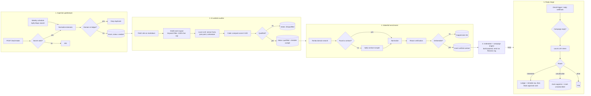

# Case Study: Multi-Stage Lead Waterfall

**Five chained n8n workflows that turn a raw list of businesses into verified, qualified, personalised outreach, and sort the replies, with a ledger that guarantees no company is processed twice.**

 -blue?style=flat-square)  

| | |
|---|---|
| **Type** | Portfolio build (reference implementation, not a client engagement) |
| **My role** | Sole designer and builder: pipeline design, scoring rubric, prompt and schema design, data model, compliance handling |
| **Scale** | 6 workflows (5 stages plus a global error handler), 75 nodes, 4 Supabase tables, 3 enrichment/verification providers |
| **Stack** | n8n, Ollama (Qwen 2.5, local), Supabase, Airtable, Apify, Tomba, Reoon, Resend, Gmail, Slack |
| **Status** | Reference implementation, exercised on sample data |

> **Resend was used for testing only.** Every send in this build went to my own address through Resend's sandbox. Do not use Resend for production cold outreach: it is a transactional email service, and sending unsolicited outreach through it violates Resend's terms of use. Swap the sender (see [Configuration and swap-ins](#configuration-and-swap-ins)) for a cold-email-appropriate provider or your own warmed mailbox before sending to real prospects.

---

## The problem

Outbound only works on clean data, and most lead lists are not clean. The same company appears three times. Half the addresses bounce. Many companies were never a fit. Sending to all of them wastes effort, burns sender reputation, and, when someone replies "remove me" and nothing happens, creates real compliance risk.

The fix is not a better email. It is a **pipeline that refuses to waste effort**: reject duplicates before they cost anything, judge fit before spending enrichment credits, verify every address before sending, and make opt-outs automatic.

## Outcome

- A company is processed **once**, enforced by a database ledger keyed on its domain.
- Fit is judged against an explicit 0-100 rubric: a **local LLM** extracts facts from the site (no per-token cost, no lead data leaves my infrastructure) and a Code node adds up the points, and only qualifying companies reach the paid enrichment stage.
- Contacts come from a **waterfall of providers** and every address is verified before it can be sent to. Failures are written to a suppression table, not retried forever.
- Replies are classified by intent; hot leads go to Slack for a human, unsubscribes are suppressed automatically.

---

## Architecture



### Stage by stage

| # | Workflow | What it does | Why it is built this way |
|---|---|---|---|
| 1 | **Ingestion gatekeeper** | Two entry points: a weekly scheduled Maps search and an authenticated webhook. Validates the secret, lowercases the domain and strips protocol and `www.`, checks Supabase for that domain, inserts new ones with status `seeded`. | Dedupe happens before any scrape, LLM or paid API call. The scheduled search pipes its results into the same webhook, so there is exactly one door. |
| 2 | **AI website auditor** | Fetches each `seeded` company's site as markdown, reduces it to the paragraphs that matter, has a local LLM extract facts, computes the score in a Code node, writes `qualified` or `disqualified`, syncs qualified accounts to an Airtable cockpit. | Scoring before enrichment means paid contact lookups only run on companies that fit. |
| 3 | **Waterfall enrichment** | For each qualified account: domain search, fall back to a contact-page scraper if that finds nothing, then verify the address. Valid becomes a contact; invalid is suppressed. | One provider failing or returning nothing does not stop the run, and no unverified address reaches the sender. |
| 4 | **Campaign engine** | Loads verified contacts that have no campaign yet, drops any whose email or domain is on the suppression list (the list is fetched once and every contact is matched individually in a Code node), asks a person to approve the batch by email, applies a daily cap, then joins the company dossier (including the icebreaker the auditor wrote), builds the payload, sends, stamps the campaign ID back on the contact, and upserts the cockpit row. | Nothing sends without approval, re-runs never double-send, and the personalisation was generated in stage 2, so sending is a cheap deterministic step. |
| 5 | **Reply triage** | Receives replies from a webhook or a Gmail trigger, ignores personal mail, classifies intent, routes. | Replies arrive from several sources; one normaliser feeds one classifier. |
| - | **Global error handler** | Logs failures to a dead-letter table and alerts DevOps. | Unattended pipelines must say when they break. |

---

## Deep dives

### The scoring rubric

The auditor does not ask "is this a good lead?". It scores against an explicit rubric, and the points are added up in code, not by the model:

| Signal | Points |
|---|---|
| Private event rooms or dedicated banquet space | +30 |
| Group capacity of at least 20 seated or 40 standing | +20 |
| Dedicated events or catering menu, or buyout packages | +20 |
| Inquiry form or event contact present | +10 |
| Relies on manual PDF quotes or generic email, no instant booking | +20 |
| Fast-casual or counter-serve only | forced to 0-25 |

The model does not produce the score. It returns typed facts: `has_private_event_space`, `max_group_capacity`, `has_events_menu_or_buyout`, `has_inquiry_form_or_event_contact`, `relies_on_manual_quotes`, `is_fast_casual_only`, plus `primary_pain_point`, `icebreaker_angle` and `reasoning`. A Code node (`Compute ICP Score`) applies the points above, and qualification (70 or above) is an IF node on that number. A small local model reports what a page says far more reliably than it adds up points, so the arithmetic lives in code: the same facts always give the same score, scores stay comparable across runs, and the `reasoning` field makes any single score auditable.

### Cutting tokens before the model sees them

A raw homepage is mostly navigation, cookie banners and footers. A small Code node splits the markdown into paragraphs, keeps only those containing event-related keywords (private, banquet, buyout, capacity, inquiry, and similar), drops obvious junk (cookie notices, privacy policy, "all rights reserved"), and stops at about **2,500 characters**. If nothing relevant is found it falls back to the first 1,500. This keeps a small local model fast and keeps it from scoring a cookie banner.

### The prompt fixes a perspective problem

A common failure in prompts like this: the model writes marketing copy for the *venue's customers* instead of a pitch to the *venue owner*. The system prompt states sender and recipient explicitly, forbids both failure modes by name, and includes good and bad few-shot icebreakers with the reason each bad one is bad. Naming the failure in the prompt is cheaper than debugging it in output.

### The waterfall order

Per account: **Tomba** domain search first; if it returns nothing, **Apify** contact-info scraper on the site; either result is normalised into one shape and then **Reoon** verifies it. `valid` and `catch_all` count as sendable. Anything else is written to the suppression table with the reason (`Deliverability verification failed: <status>`), including accounts where no contact was found at all. One normaliser, one verifier, two sources.

### Reply triage and compliance

The classifier returns one of four intents, `INTERESTED`, `OBJECTION`, `OOO`, `UNSUBSCRIBE`, plus urgency and a two-sentence draft reply. A Switch routes each:

- **Interested:** written to the replies ledger and Airtable, and a Slack card goes to a human with the draft. The model drafts; a person sends.
- **Low confidence (below 0.7):** written to the replies ledger as `needs_human_review` instead of auto-routing.
- **Unsubscribe:** matched first, at any confidence; the sender is written to the suppression table and marked unsubscribed in Airtable, immediately and with no human step.
- **Anything else:** logged.

Opt-out handling being automatic is the compliance-critical part of the design.

---

## Decision log

### Decision 1: a local LLM for scoring
- **Options:** hosted frontier model vs local Qwen 2.5 on Ollama.
- **Chose local.** Scoring runs on every seeded lead, most of which get rejected, so per-token cost scales with the *worst* part of the funnel. Local also means scraped lead data never leaves my server.
- **Trade-off:** a small model follows a rubric less reliably than a large one. In an early version the model returned the score itself and its totals did not follow the rubric (a test run qualified nothing), so the model now only extracts facts and a Code node computes the score. Fact extraction can still miss content that is not on the homepage, because only the homepage is fetched.

### Decision 2: a database ledger, not workflow memory
- Dedupe lives in Supabase keyed on domain with a unique index (a conflicting insert is treated as a duplicate), so it survives restarts and is shared by every stage and every entry point. Cost: a lookup per lead.

### Decision 3: waterfall with a single verifier
- Two sources feed one Reoon verification step. Cost: verification credits are spent on every candidate; benefit: nothing unverified reaches the sender regardless of source.

### Decision 4: one stage per workflow
- Independently testable and re-runnable. Cost: more workflows to import and link, and Execute Workflow IDs to manage (these are placeholders in this export).

### Decision 5: suppression as a shared table
- Both the verifier and the reply triager write to the same `outbound_suppression` table, so there is one source of truth for "never contact".

---

## Failure modes I designed for

| What goes wrong | What happens |
|---|---|
| Same company submitted twice | Dropped at the ledger before any cost |
| Unauthorised caller | `401` before any processing |
| Site has no useful content | Distiller falls back to the first 1,500 characters; the model scores what it has |
| First enrichment provider finds nothing | Falls through to the scraper |
| Email fails verification | Suppressed with a reason, never sent to |
| Workflow re-run | Contacts that already have a campaign ID are skipped |
| Contact suppressed after verification | Suppression list is checked again before the send |
| One suppressed contact among several in a batch | Matched individually: that contact is dropped, the others continue |
| Prospect asks to be removed | Auto-suppressed and marked in the CRM |
| Any workflow throws | Global error handler logs to DLQ and alerts DevOps |

## Data model

| Table | Purpose |
|---|---|
| `outbound_companies` | The ledger: `domain` (unique key in practice), `company_name`, `website_url`, `city`, `state`, `vertical`, `status` (`seeded`, `qualified`, `disqualified`), `icp_score`, dossier fields |
| `outbound_contacts` | Verified contacts: `company_id`, name, `email`, `job_title`, `enrichment_source`, `deliverability_status`, `assigned_campaign_id`, `resend_message_id` |
| `outbound_suppression` | Never-contact list: `email_or_domain`, `type`, `reason` |
| `outbound_inbound_replies` | Classified replies: `prospect_email`, `sentiment`, `reply_body`, `ai_draft_response` |

Airtable holds the human-facing cockpit (qualified accounts, hot leads) and the DLQ.

## Testing and verification

The engine was tested stage by stage on synthetic data, with no real prospect contacted. Scoring and reply classification ran on a local model on a single VM; paid provider calls were capped at 10 accounts. Every real send went to the author's own address, and the rest were logged without sending.

| Stage | What was run | Result |
|---|---|---|
| 1. Ingestion | 109 leads in one batch (100 unique, 9 duplicate or URL variants) | 100 inserted, 9 of 9 duplicates dropped, 74 s in total; a wrong secret returned 401 in 0.6 s |
| 2. Website audit | 100 business sites, then a 40-site stratified sample after scoring moved into code | With the model computing the score, 0 of 100 qualified (scores 0 to 65, no separation between venues and non-venues). With the model extracting facts and code computing the score, 7 of 40 qualified, 0 of 16 non-venue and fast-casual sites qualified, and the highest non-venue score fell from 65 to 30 |
| 3. Enrichment | 10 live accounts through Tomba, the Apify fallback and Reoon | 8 of 10 yielded a candidate address (5 from Tomba, 3 from the fallback); 2 of those 8 passed verification and 6 were suppressed with a reason (2 invalid, 4 unverifiable) |
| 4. Campaign engine | 100 synthetic contacts through the send gate, a log-only sender and one real email | 95 eligible after skipping contacts that already had a campaign; 12 of 12 suppressed addresses blocked (10 by domain, 2 by exact address); the daily cap held the batch at 5; 0 suppressed addresses reached the batch; the real email was sent in 1.5 s |
| 5. Reply triage | 60 synthetic replies: interested, objection, out of office, unsubscribe and adversarial | 54 of 55 labelled replies classified correctly; 15 of 15 unsubscribes routed to suppression; 0 of 40 other replies suppressed; 60 of 60 routed consistently with their classification |

### Scope and limits of these results

- **Data and size:** synthetic inputs and well-known sites, one run each. The scoring comparison used 40 sites and the live enrichment run used 10 accounts, so the rates are indicative, not statistical.
- **Website audit:** only the homepage is fetched. Sites that publish event details on a separate page did not qualify, which includes all 8 large hotel sites in the sample.
- **Enrichment:** calls to the contact finder are not spaced, and 5 of 10 made in quick succession were rate-limited; the fallback recovered 3 of those 5. The first address the finder lists is not necessarily an events contact. Large mail providers often return an unverifiable result, which is suppressed rather than sent to.
- **Campaign engine:** the approval email was replaced by an automatic approval, and the campaign-ID write-back and CRM update were outside the test, so the re-run guard was not measured.
- **Reply triage:** both explicit instruction-injection attempts in the adversarial set (2 of 2) were classified as interested; the human approval before any send contains this. No reply scored below the 0.7 confidence threshold, so the human-review route was not triggered, and the ledger, CRM and chat writes were logged rather than executed in this run.

[`samples/lead-intake.json`](samples/lead-intake.json) is a ready payload for stage 1 if you want to repeat the ingestion checks.

## Configuration and swap-ins

Everything below is a setting or a node swap, not a rewrite. The defaults are what I used because they are free or cheapest, not because the design needs them.

| What | Default here | Change it to |
|---|---|---|
| **Scoring LLM** | Local Qwen 2.5 on Ollama | Any hosted or local model. A larger model follows the rubric more reliably; a hosted one removes the need to run Ollama. |
| **ICP rubric and cut-off** | Event-venue rubric, qualified at 70 or above | Rewrite the prompt for any niche and change the threshold. Nothing else depends on the industry. |
| **Intake authentication** | Shared-secret header (`x-intake-secret`) checked in the workflow | Any header name, or the webhook's built-in Header Auth credential. |
| **Lead source** | Apify Google Maps actor, weekly | Any scraper, CSV upload, or CRM export. Anything that can POST to the intake webhook works. |
| **Contact finder** | Tomba, then Apify contact scraper | Hunter, Apollo, Snov, Dropcontact, or your own scraper. The Normalize step maps any provider to one shape. |
| **Email verifier** | Reoon | ZeroBounce, NeverBounce, Kickbox, MillionVerifier. Change the HTTP node and the "valid" condition. |
| **Sender** | Resend (testing only, not for production cold outreach) | A cold-email-appropriate sender: Gmail or SMTP on a warmed mailbox, Instantly, Smartlead. Required before any real send. |
| **Ledger and CRM** | Supabase and Airtable | Postgres, Notion, Sheets, HubSpot. Keep the unique-domain rule. |
| **Content distiller** | Event keywords, 2,500 character cap | Your own keyword list and size limit. |
| **Reply classes** | Interested, objection, out of office, unsubscribe | Add or rename; update the Switch. |
| **Schedule and batch size** | Weekly, 5 places | Any. |

## What this demonstrates

- **Pipeline design ordered by cost**, with idempotency enforced in a database.
- **Local LLM use** with a rubric, a typed schema and pre-processing to control tokens.
- **Multi-provider enrichment** with fallback and verification.
- **Compliance-aware automation**: suppression and opt-out handling built into the flow.
- **Modular workflow architecture** (Execute Workflow chaining) and a shared error handler.
- **Human-in-the-loop gates**: send approval, daily cap and a confidence threshold on replies.

## Repository

| File | Purpose |
|---|---|
| [`workflows/01-lead-sourcing-ingestion-gatekeeper.json`](workflows/01-lead-sourcing-ingestion-gatekeeper.json) | Ingest, authenticate, normalise, dedupe |
| [`workflows/02-ai-website-auditor-icp-scoring.json`](workflows/02-ai-website-auditor-icp-scoring.json) | Fetch site, distil, score with local LLM, sync |
| [`workflows/03-waterfall-enrichment-deliverability.json`](workflows/03-waterfall-enrichment-deliverability.json) | Contact lookup waterfall and verification |
| [`workflows/04-icebreaker-campaign-engine.json`](workflows/04-icebreaker-campaign-engine.json) | Build payload, send, log |
| [`workflows/05-reply-triage-slack-hitl.json`](workflows/05-reply-triage-slack-hitl.json) | Classify replies, suppress, alert |
| [`workflows/06-error-handler-dlq.json`](workflows/06-error-handler-dlq.json) | Global error handler |
| [`samples/lead-intake.json`](samples/lead-intake.json) | Sample request payload |
| [`schema/migrations.sql`](schema/migrations.sql) | Unique domain index and column rename |

### Run it yourself
1. Import the six workflows into n8n. All are exported **inactive**.
2. Replace every placeholder (`REPLACE_ME`, `YOUR_*`, `WORKFLOW_ID_*`), re-select credentials, and re-link the Execute Workflow nodes and the Error workflow setting to your imported copies.
3. Create the four Supabase tables and the Airtable cockpit, then run [`schema/migrations.sql`](schema/migrations.sql). Pull a Qwen 2.5 model into Ollama.
4. Send the sample payload:

   ```bash
   curl -X POST https://YOUR-N8N-HOST/webhook/lead-intake \
     -H "x-intake-secret: YOUR_SHARED_SECRET" \
     -H "Content-Type: application/json" \
     -d @samples/lead-intake.json
   ```

### Responsible use
Do not send real outreach through Resend; see the note at the top.

Scraping and cold email are regulated. Respect site terms, include a real opt-out and postal address, honour the suppression list, and check CAN-SPAM, GDPR and PECR for your jurisdiction before sending. This is a pipeline design, not an invitation to send unsolicited bulk mail.

Brand names, people and addresses are fictional demo data. MIT licensed.

